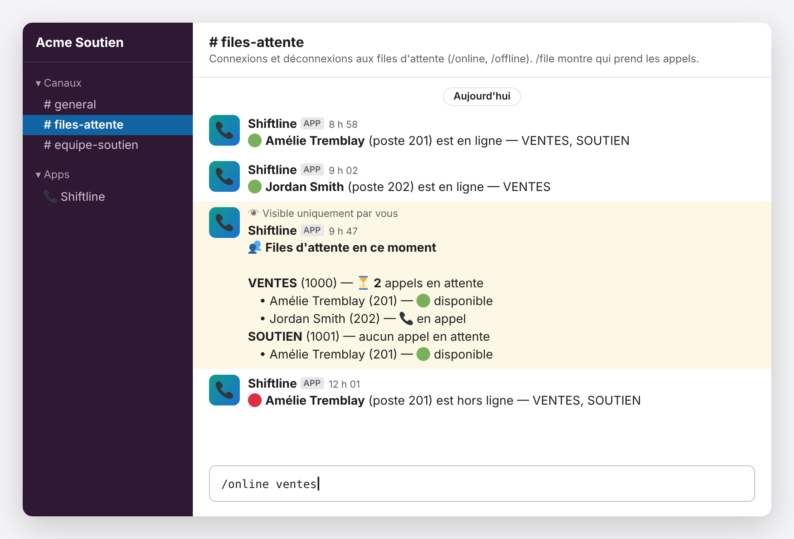

# Shiftline

**Vos agents se connectent aux files d'attente FreePBX depuis Slack, sans ouvrir aucun port sur votre serveur téléphonique.**

[English version](README.md) · [Installation serveur](docs/INSTALLATION-SERVEUR.fr.md) · [Guide des agents](docs/GUIDE-AGENTS.fr.md) · [Exploitation](docs/EXPLOITATION.fr.md) · [Sécurité](SECURITY.md) · Licence MIT



<sub>Illustration avec des noms fictifs. Emojis : [Twemoji](https://github.com/jdecked/twemoji), CC-BY 4.0.</sub>

Les agents oublient de composer `*45`, ou ne peuvent pas le faire depuis un softphone en télétravail.
Ce bot met la connexion aux files là où l'équipe est déjà : dans Slack. Chaque changement est annoncé
dans un canal : tout le monde sait qui prend les appels.

## Fonctionnalités

- **`/online`**, **`/offline`** : se connecter (ou se déconnecter) à toutes ses files, ou à une seule
  (`/online ventes`).
- **`/file`** (ou `/queues`) : les appels en attente dans chaque file, et qui est en ligne avec son
  état en direct (disponible, en appel, sonne, en pause, téléphone non joignable).
- **Annonces** dans le canal de votre choix ; les erreurs sont toujours signalées en privé.
- **Même comportement que `*45`** : un agent connecté par téléphone apparaît dans Slack, et inversement.
- **Chacun ne gère que son propre poste** : chaque compte Slack est relié à un poste.
- Messages en **français ou en anglais** (`LANGUAGE = "fr"` ou `"en"`).
- **Sans serveur** : un seul Worker Cloudflare (le forfait gratuit suffit), aucune base de données.

## La sécurité d'abord

L'interface AMI d'Asterisk est puissante : un compte AMI peut lancer des appels ou exécuter des
commandes. Ce projet ne l'expose jamais. Une requête doit franchir **quatre barrières** :

```
Slack ──signé──▶ Worker Cloudflare ──X-Edge-Key──▶ Règle de pare-feu Cloudflare
                                                      │ (bloque tout ce qui n'a pas la clé)
                                                      ▼
                                   Tunnel Cloudflare (seulement /rawman, aucun port ouvert)
                                                      ▼
                     Gardien AMI sur le serveur, 127.0.0.1:8090 (server/ami-gate.py)
                     un seul utilisateur AMI, 6 actions, vos files et vos postes seulement
                                                      ▼
                     Asterisk, 127.0.0.1:8088 — utilisateur AMI avec les droits « agent » et « user » seulement
```

1. **Signature Slack** : chaque commande est vérifiée (HMAC-SHA256, fenêtre de 5 minutes).
2. **Règle de pare-feu Cloudflare** : l'adresse du tunnel répond `403` à tout ce qui n'a pas la clé du Worker.
3. **Tunnel Cloudflare** : connexion sortante seulement depuis le serveur ; seul `/rawman` est transmis.
4. **Gardien AMI** : un petit programme Python (bibliothèque standard seulement, environ 200 lignes,
   facile à auditer). Il revérifie la clé et n'accepte qu'un utilisateur AMI, les actions `Login`,
   `Logoff`, `QueueAdd`, `QueueRemove`, `QueueStatus` et `UserEvent` avec leurs seuls paramètres
   permis, et vos files et postes. Il refuse toute requête ambiguë (paramètre en double ou inconnu,
   caractères de contrôle) et reconstruit la requête qu'il transmet. Il tourne comme service
   systemd isolé.

Sans le gardien, n'importe quel compte AMI (dont le compte interne de FreePBX, qui a tous les droits)
serait utilisable par le tunnel, puisque tout ce qui en sort arrive à Asterisk « depuis 127.0.0.1 ».

## Ce qu'il faut

- **FreePBX 17** (Asterisk 20+), testé sur FreePBX 17.0.33 / Asterisk 22 / Debian 12, avec SSH et `sudo`.
- Des files dont les agents sont des **agents dynamiques** (*Dynamic Agents*).
- Un espace **Slack** où vous pouvez installer une application.
- Un compte **Cloudflare** avec un domaine géré par Cloudflare (pour l'adresse du tunnel).
- **Node.js 18+** et **Git** sur votre ordinateur.
- Un **gestionnaire de mots de passe** pour les secrets (voir [la liste](docs/EXPLOITATION.fr.md#valeurs-à-garder-dans-votre-gestionnaire-de-mots-de-passe)).

## Démarrage rapide

Environ deux heures la première fois. Faites les étapes dans l'ordre : chacune a besoin de la
précédente. Notez les valeurs dans votre gestionnaire de mots de passe au fur et à mesure.

> Les menus de **api.slack.com**, de **Cloudflare** et de **FreePBX** sont en anglais : ils sont
> écrits ici en anglais. Ceux de Slack suivent la langue de votre Slack.

**1. Récupérer le code**

```bash
git clone https://github.com/dufoursim/shiftline.git
```

```bash
cd shiftline && npm install && npm test
```

```bash
cp wrangler.example.toml wrangler.toml
```

Dans `wrangler.toml`, mettez `LANGUAGE = "fr"` et adaptez `AMI_URL` (adresse du tunnel), `QUEUES`
et `AGENTS` (nom, poste, files ; laissez `slack` vide pour l'instant).

**2. Mettre le Worker en ligne**

```bash
npx wrangler login
```

```bash
npm run deploy
```

Notez l'adresse du Worker, ex. `https://shiftline.VOTRE-SOUS-DOMAINE.workers.dev`.

**3. Créer l'application Slack**

Ouvrez [`slack-manifest.json`](slack-manifest.json) et remplacez `YOUR-SUBDOMAIN` (3 fois) et le nom
du bot. Pour des commandes en français, remplacez aussi `/queues` par `/file` et traduisez les
descriptions. Puis <https://api.slack.com/apps> → **Create New App** → **From a manifest** →
collez → **Create** → **Install to Workspace**. Copiez le **Bot User OAuth Token** (`xoxb-…`) et,
dans **Basic Information** → **App Credentials**, le **Signing Secret**. ⚠️ Pas le *Client Secret*,
ni le *Verification Token*, ni un *App-Level Token* (`xapp-…`) : Shiftline ne les utilise pas.

Dans Slack, créez le canal des annonces, ajoutez-y le bot (nom du canal → **Intégrations** →
**Ajouter une application**), et copiez son **ID de canal** dans `ANNOUNCE_CHANNEL`. Pour chaque
agent, copiez son **ID de membre** (profil → **⋮** → **Copier l'ID de membre**) dans `slack` de `AGENTS`.

**4. Préparer FreePBX** (interface web)

- **Applications → Queues** → chaque file → **Queue Agents** : le poste de chaque agent est dans
  **Dynamic Agents** sous la forme `POSTE,PÉNALITÉ` (ex. `201,0`). **Submit**, **Apply Config**.
- **Settings → Asterisk Manager Users → Add Manager** :

  | Champ | Valeur |
  |---|---|
  | Manager name | `shiftline` |
  | Manager secret | environ 24 **lettres et chiffres** au hasard (le gardien refuse les autres caractères) |
  | Deny | `0.0.0.0/0.0.0.0` |
  | Permit | `127.0.0.1/255.255.255.255` |
  | Write Timeout | `100` |
  | Droits (Rights) | **seulement** `agent` (Read + Write) et `user` (Write, pour les `UserEvent` que `*45` envoie aussi) |

  **Submit**, **Apply Config**.

**5. Protéger l'adresse** (avant que le tunnel existe)

Inventez une clé d'environ 40 lettres et chiffres (`PBX_EDGE_KEY`). Cloudflare → votre domaine →
**Security** → **Security rules** → **Create rule** → **Custom rule**, action **Block** :

```
(http.host eq "pbx-api.example.com" and not any(http.request.headers["x-edge-key"][*] eq "VOTRE_CLÉ"))
```

**6. Installer le serveur**

Suivez **[docs/INSTALLATION-SERVEUR.fr.md](docs/INSTALLATION-SERVEUR.fr.md)** : AMI en HTTP,
gardien AMI, tunnel Cloudflare.

**7. Enregistrer les secrets et remettre en ligne**

```bash
npx wrangler secret put SLACK_BOT_TOKEN
```

```bash
npx wrangler secret put SLACK_SIGNING_SECRET
```

```bash
npx wrangler secret put AMI_USERNAME
```

```bash
npx wrangler secret put AMI_SECRET
```

```bash
npx wrangler secret put PBX_EDGE_KEY
```

```bash
npm run deploy
```

**8. Tester**

| # | Action | Résultat attendu |
|---|---|---|
| 1 | `curl -s -o /dev/null -w "%{http_code}\n" "https://pbx-api.example.com/rawman?action=Ping"` (Windows : `curl.exe` et `NUL`) | `403` (bloqué sans la clé) |
| 2 | Dans Slack : `/file` | Vos files, « aucun appel en attente », « Personne en ligne » (ou les agents connectés) |
| 3 | `/online ventes` | Annonce 🟢 dans le canal (et confirmation privée si tapée ailleurs) |
| 4 | `/file` | Vous apparaissez sous la file, « disponible » |
| 5 | `/offline ventes` | Annonce 🔴 |
| 6 | Composez `*45` sur votre téléphone, puis `/file`, puis `/offline` | Vous apparaissez connecté, puis déconnecté : `*45` et Shiftline s'entendent |

En cas de problème : [Dépannage](#dépannage), et `npx wrangler tail` pour voir l'erreur exacte.

**9. Terminer** : suivez la [liste « après l'installation »](docs/EXPLOITATION.fr.md#après-linstallation)
et partagez le [guide des agents](docs/GUIDE-AGENTS.fr.md) avec votre équipe.

## Configuration

| Nom | Où | Quoi |
|---|---|---|
| `AMI_URL` | `wrangler.toml` | Adresse du tunnel, ex. `https://pbx-api.example.com` |
| `ANNOUNCE_CHANNEL` | `wrangler.toml` | ID du canal Slack des annonces (`""` pour aucune) |
| `LANGUAGE` | `wrangler.toml` | `fr` ou `en` (par défaut) |
| `QUEUES` | `wrangler.toml` | `"1000" = { name = "VENTES", alias = "ventes" }` |
| `AGENTS` | `wrangler.toml` | `{ name, extension, slack, queues = ["1000"] }` |
| `SLACK_BOT_TOKEN` | secret | Jeton du bot (`xoxb-…`) |
| `SLACK_SIGNING_SECRET` | secret | Secret de signature de l'application Slack |
| `AMI_USERNAME`, `AMI_SECRET` | secret | L'utilisateur AMI limité |
| `PBX_EDGE_KEY` | secret | Même clé que la règle de pare-feu et `/etc/ami-gate/edge-key` |

## Fonctionnement

1. Slack envoie la commande à `POST /slack/commands`. Le Worker vérifie la signature, trouve l'agent
   par son ID Slack, répond tout de suite à Slack (limite de 3 secondes), puis continue en arrière-plan.
2. Il appelle `AMI_URL/rawman` : `Login`, les actions, `Logoff`.
3. Les actions reprennent celles de `*45` dans FreePBX (`macro-toggle-add-agent` /
   `macro-toggle-del-agent`) : `QueueAdd` avec `Local/POSTE@from-queue/n` et
   `hint:POSTE@ext-local`, puis `UserEvent AgentLogin` ; `QueueRemove` des formats `from-queue` et
   `from-internal`, puis `UserEvent RefreshQueue`. Seule différence : les voyants BLF de file
   (`DEVICE_STATE(Custom:QUEUE…)`) ne sont pas mis à jour, car il faudrait le droit AMI `call`,
   beaucoup plus large.
4. Le résultat revient en privé par la `response_url` de Slack, et l'annonce par `chat.postMessage`.

## FAQ

**Pourquoi l'AMI d'Asterisk et pas l'API REST/GraphQL de FreePBX ?** L'API de FreePBX sert à la
*configuration* (créer des files, des postes…) ; elle ne connecte pas les agents en direct. Les
actions AMI `QueueAdd` / `QueueRemove` sont celles qu'utilise `*45` de FreePBX, et `QueueStatus`
donne l'état en direct. L'ARI d'Asterisk pilote des appels, pas les membres des files : elle ne
convient pas non plus.

**FreePBX et Asterisk vont-ils se désynchroniser ?** Non : Shiftline écrit exactement ce qu'écrit
`*45` (même interface de membre, même interface d'état, mêmes `UserEvent`, retrait des deux
formats). Un agent connecté par téléphone peut se déconnecter depuis Slack, et inversement. Seuls
les voyants BLF de file (`DEVICE_STATE(Custom:QUEUE…)`) ne sont pas mis à jour : si vos téléphones
les utilisent, ils peuvent afficher un mauvais état après une connexion par Slack.

**Faut-il un forfait Cloudflare payant ?** Non. Le Worker, le tunnel et une règle de pare-feu
personnalisée entrent dans le forfait gratuit.

**Un agent peut-il connecter ou déconnecter quelqu'un d'autre ?** Non. Chaque compte Slack est
relié à un seul poste, et le gardien sur le serveur n'accepte que les postes que vous listez.

**Et si Cloudflare ou Slack est en panne ?** `*45` continue de fonctionner : Shiftline ajoute une
façon de se connecter, il ne remplace pas celle du téléphone.

## Fichiers

- `src/` : le Worker (`index.js` commandes Slack, `queues.js` files et agents, `ami.js` client AMI,
  `messages.js` textes en anglais et en français)
- `server/ami-gate.py`, `server/ami-gate.service` : le gardien AMI du serveur
- `test/` : tests du Worker et du gardien
- `wrangler.example.toml`, `slack-manifest.json` : modèles à copier
- `docs/` : installation serveur, guide des agents, exploitation (en anglais et en français)

## Développement

```bash
npm test
```

```bash
npm run test:gate
```

`npm test` lance les tests du Worker (Slack et FreePBX simulés) ; `npm run test:gate` lance ceux du
gardien (ce qu'il refuse, et un aller-retour avec un faux Asterisk). `npx wrangler tail` montre le
journal en direct du Worker déployé.

## Dépannage

| Ce que vous voyez | Cause probable | Quoi faire |
|---|---|---|
| ⚠️ … HTTP 403 | Clé différente entre le Worker, la règle de pare-feu et le gardien, ou poste/file absent de `GATE_EXTENSIONS` / `GATE_QUEUES` | `sudo journalctl -u ami-gate -n 50` dit lequel |
| ⚠️ … HTTP 404 | Mauvais chemin : `AMI_URL`, le `path:` du tunnel, ou préfixe HTTP d'Asterisk absent de `GATE_UPSTREAM` | `sudo asterisk -rx "http show status"` |
| ⚠️ … HTTP 502 / 530 | Tunnel ou gardien arrêté | `sudo systemctl status cloudflared ami-gate` |
| ⚠️ connexion AMI refusée | `AMI_SECRET` différent de FreePBX | Mettre le même mot de passe aux deux endroits |
| « relié à aucun poste » | ID Slack absent de `AGENTS` | L'ajouter et redéployer |
| Pas d'annonce | Bot absent du canal (`not_in_channel` dans `wrangler tail`) | Ajouter l'application au canal |
| `dispatch_failed` dans Slack | Mauvaise Request URL de la commande | api.slack.com → **Slash Commands** |

## Soutenir le projet

Shiftline est gratuit et entretenu sur du temps libre. S'il fait gagner du temps à votre équipe,
vous pouvez soutenir son développement avec [GitHub Sponsors](https://github.com/sponsors/dufoursim)
(le bouton **❤️ Sponsor** en haut de cette page). Une étoile, un signalement de bogue ou une PR
aident aussi.

## Licence

[MIT](LICENSE) © 2026 Simon Dufour. Les contributions sont les bienvenues : voir [CONTRIBUTING.md](CONTRIBUTING.md).
